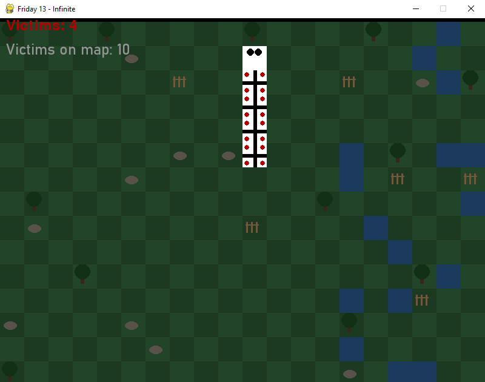
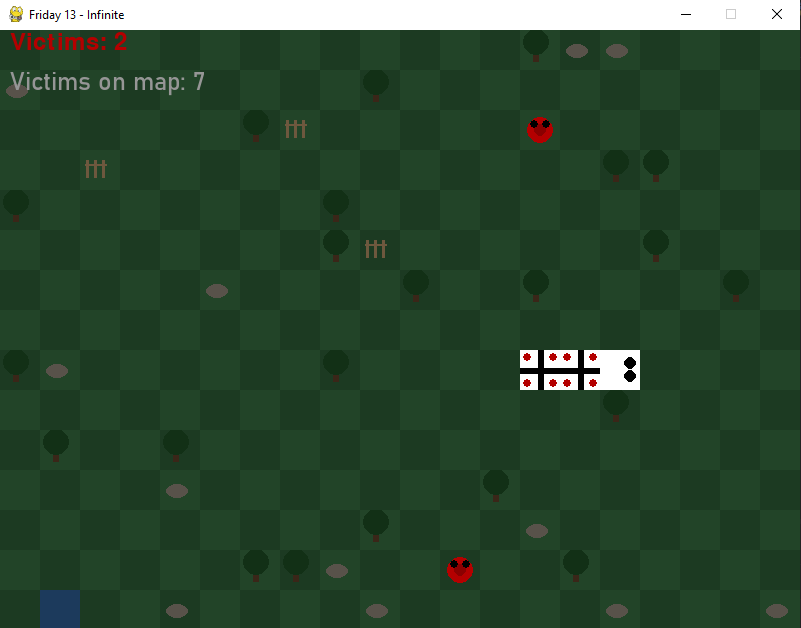
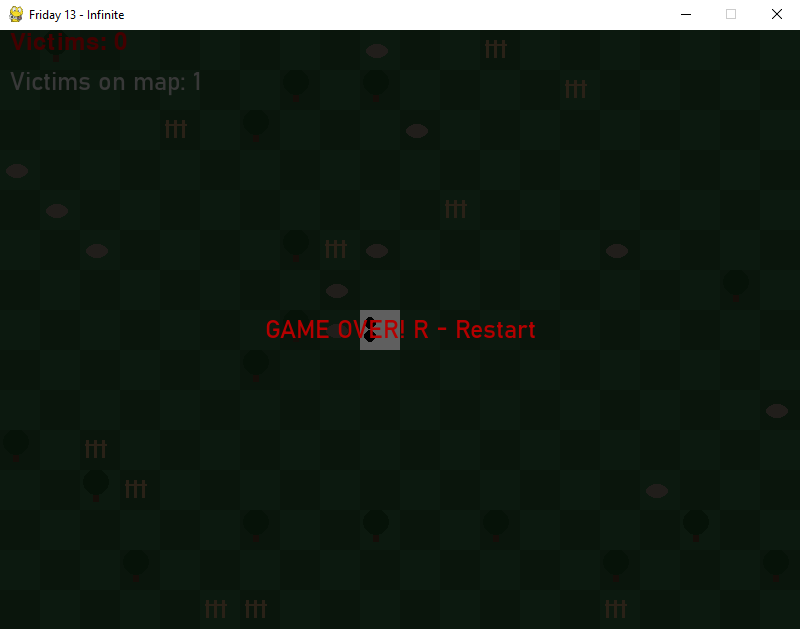

# Friday 13 - II

> Endless Snake with obstacles and dynamic world generation.

| Project Information | Details |
|---|---|
| Project ID | NS-004 |
| Direction | Games |
| Development Phase | Phase I |
| Version | v1.1 |
| Platform | Windows / Python |
| Status | Completed |

> 

## 📖 Overview

An endless interpretation of Snake that introduces a procedurally generated world with environmental obstacles and an expanding play area.

## ✨ Features

- Endless gameplay

- Procedural chunk-based world generation

- Trees, rocks, lakes and fences

- Dynamic food generation

- Persistent local best score

## 🛠 Technology Stack

- Python
- Pygame
- JSON

## 📦 Installation

- Download the Windows executable from Releases: [more...](https://github.com/NebulaStack-prog/Friday-13-II/releases/tag/v2.0)

- Or run with Python latest version of code: [more...](Friday13-II-v2.py)

- Original source code: [more...](Friday13-II.py)

## 📊 Project Status

A completed NESTIMS Phase I project. Both the original and updated Python implementations are preserved.

## 📸 Screenshots

© NESTIMS
